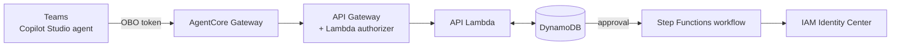

# Agentic just-in-time access for AWS

Let an AI agent in Microsoft Teams request temporary, least-privilege access to AWS accounts. An account owner
approves the exact policy. AWS IAM Identity Center grants the access, and a workflow removes it when the time
is up.

**The agent can propose access. It can never grant it.**

> **Status: alpha.** The code has 123 unit tests, and the infrastructure has 14 plan tests against a mocked
> provider. The complete flow has not been run against a real AWS account and a real Entra ID tenant from
> this repository yet. Try it in a sandbox first, and read [docs/security.md](docs/security.md) before it
> protects anything important.

## How it works

1. An engineer describes a task in Teams: *"I need to read the dev secrets in account 111122223333 for two
   hours to debug incident 4711."*
2. A Microsoft Copilot Studio agent proposes a narrow policy, shows it with the duration and the reason, and
   asks for confirmation.
3. The request reaches AWS through Amazon Bedrock AgentCore Gateway with the engineer's own identity, using
   Microsoft Entra ID On-Behalf-Of authentication.
4. An owner or deputy of the account sees the exact policy and its fingerprint, and approves that version.
5. A Step Functions workflow creates a temporary permission set in IAM Identity Center and assigns it to the
   engineer. A role named `jit_...` appears in their AWS access portal.
6. When the duration ends, the same workflow removes everything. Every failure path removes it too.



See [docs/architecture.md](docs/architecture.md) for the details.

## Why this design

| | |
|---|---|
| **The agent has no identity of its own** | Every call carries the signed-in person. The same agent serves requesters and approvers, who stay distinct. |
| **Requesting for someone else is impossible** | The API takes the requester from the verified token. The request has no field for it. |
| **The approver approves one policy version** | The approval carries a fingerprint of the reviewed policy, checked against the stored policy in a conditional write. |
| **Rules live in the API, not the prompt** | Ownership, self-approval, durations, and allowed policies are enforced and tested in code. |
| **Access ends by itself, even on failure** | Every path through the workflow ends in revocation, and created resources are saved as they are made. |
| **Small tool surface** | The agent has five tools, generated from the API's OpenAPI document. It has no other path to AWS. |

## What is in the box

- An API with five operations: request, list, get, approve, reject.
- A Lambda authorizer that validates Microsoft Entra ID tokens.
- An AgentCore Gateway, configured for Entra ID, with an interceptor that forwards the caller's token.
- A Step Functions workflow that grants and removes access in IAM Identity Center.
- Terraform for all of it, the agent's instructions and knowledge file, and setup guides.

**Not included, on purpose:** user, group, or permission set management, projects and organizations, other
identity providers, other chat platforms, a web interface. This is the just-in-time part only.

## Prerequisites

- An AWS account that administers **IAM Identity Center** (the management account or the delegated
  administrator), and its region.
- A Microsoft Entra ID tenant where you can create app registrations, and Copilot Studio with Teams.
- IAM Identity Center users that match your Entra ID users (for example through SCIM provisioning).
- Python 3.12, Terraform 1.6+ or OpenTofu, the AWS CLI, and `make`.

## Quick start

```bash
git clone <this repository> && cd agentic-jit-access-aws
make venv

# 1. Entra ID: create the two app registrations (docs/entra-setup.md)

# 2. Configure
cp infra/terraform/terraform.tfvars.example infra/terraform/terraform.tfvars
$EDITOR infra/terraform/terraform.tfvars    # tenant, audiences, accounts and approvers

# 3. Deploy
make init
make apply                                  # builds, then deploys

# 4. Connect the gateway to the API's OpenAPI document
make publish

# 5. Create the agent in Copilot Studio (docs/copilot-studio.md)
```

Use `make TF=tofu ...` for OpenTofu. The Terraform output `gateway_mcp_url` is the server URL for Copilot
Studio. Do the setup guides in order:

1. [docs/entra-setup.md](docs/entra-setup.md)
2. [docs/copilot-studio.md](docs/copilot-studio.md)

## Configuration

The most important settings. All of them are in [`infra/terraform/variables.tf`](infra/terraform/variables.tf).

| Variable | Default | Meaning |
|---|---|---|
| `entra_tenant_id` | required | Only tokens from this tenant are accepted. |
| `entra_api_audiences` | required | The service app's client ID, as `<id>` and `api://<id>`. |
| `accounts` | required | AWS accounts that can be requested, with their owners and deputies. |
| `strip_username_domains` | `[]` | Domains removed from sign-in names to get the Identity Center user name. |
| `max_duration_hours` | `8` | The longest access a request can ask for (1 to 72). |
| `allow_self_approval` | `false` | Let an approver approve their own request. Keep it off in production. |
| `allowed_managed_policy_arns` | `[]` | If not empty, the only managed policies a request may use. |
| `permission_set_session_duration` | `PT1H` | Session length of the temporary role. Keep it short. |
| `approval_window_hours` | `24` | How long a request can wait for a decision. |
| `alarm_topic_arn` | `""` | SNS topic for failed workflows. Strongly recommended. |

## The API

| Operation | Method and path |
|---|---|
| `request_access` | `POST /jit/request-access` |
| `list_requests` | `GET /jit/requests?AccountId=&Status=` |
| `get_request` | `GET /jit/request?RequestId=` |
| `approve_request` | `POST /jit/approve?RequestId=&ExpectedPolicyFingerprint=` |
| `reject_request` | `POST /jit/reject?RequestId=` |

A request is flat. It has no field for the requester:

```json
{
  "AccountId": "111122223333",
  "Reason": "Read dev secrets to debug incident 4711",
  "DurationHours": 2,
  "PolicyDocument": {
    "Version": "2012-10-17",
    "Statement": [{
      "Effect": "Allow",
      "Action": ["secretsmanager:DescribeSecret", "secretsmanager:GetSecretValue"],
      "Resource": "arn:aws:secretsmanager:eu-central-1:111122223333:secret:dev/*"
    }]
  }
}
```

Run `python scripts/generate_openapi.py build/openapi.json` for the full OpenAPI document.

## Security

Read [docs/security.md](docs/security.md). It has the threat model, what the fingerprint does and does not
prove, the known limits, and a checklist for production. In short:

- Prompt injection, and what the agent shows an approver, are not fully solved by a fingerprint. Use
  per-tool confirmation and, ideally, a platform-rendered approval view.
- Removing access does not end sessions already in progress. Keep the session duration short.
- The workflow role can assign any policy to any user. Protect it like an Identity Center administrator.

To report a vulnerability, see [SECURITY.md](SECURITY.md).

## Development

```bash
make test     # 123 unit tests, with in-memory DynamoDB
make lint
make build    # Lambda packages and the OpenAPI document
cd infra/terraform && tofu init -backend=false && tofu test    # plan tests, no credentials
```

See [CONTRIBUTING.md](CONTRIBUTING.md).

## Roadmap

- An end-to-end test in a sandbox account, and a recorded run.
- An approval view rendered by the platform, so the approver sees the policy without the agent in between.
- A way for requesters to end access early.
- Terraform for the Entra ID app registrations.
- Conditions on who may request which account.

## License

Apache License 2.0. See [LICENSE](LICENSE).
# agentic-jit-access-aws
